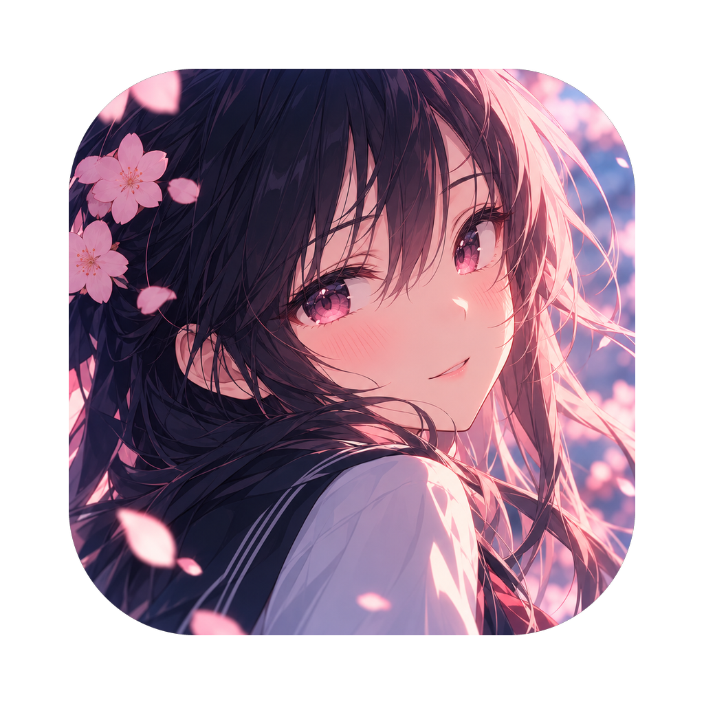

<p align="center">
  
</p>

<h1 align="center">Retrasmetter</h1>

<p align="center">
  A dictionary layer for visual novels and JRPGs on macOS.<br>
  Click any word in a game's dialogue, get an in-context translation, save it, and send it to Anki.
</p>

---

## What it does

Retrasmetter quietly watches the dialogue box of the game you are playing. Press **⌥Q** to enter **Reading Mode**: the text becomes clickable.

- **Click a word** or **drag across a phrase** → a small popup appears right next to it.
- The popup shows the **translation in the context of the sentence**, a 🔊 **pronunciation** button, **+ Vocabulary**, **+ Anki** and **More** (translate the whole sentence, explain with AI).
- **Esc**, the hotkey again, or a click outside leaves Reading Mode. The game keeps keyboard focus the whole time.

Built for learning English from games like *Persona 5*, with Russian as the default target language (also German, Turkish, Spanish, French).

## Features

- **Passive monitoring** of only the dialogue area (ScreenCaptureKit + change detection + OCR cooldown) — typewriter text is recognized once it settles. Works at ≤ 4 checks per second.
- **Game profiles**: pick the game window once; the dialogue area follows the window when it moves.
- **Personal vocabulary** (SwiftData): words and phrases with several contexts per item, status *New / Learning / Known / Ignored*, times seen, source game, search and filters.
- **Anki** via AnkiConnect: cloze-style cards (sentence with a blank + expression; back with translation, full sentence, game). Duplicates are detected.
- **Translation providers**: Apple Translation (on-device, free), a local LibreTranslate server, and optional **DeepL** / **OpenAI** with *your own* API key.
- **Interface in 6 languages**: English, Русский, Deutsch, Türkçe, Español, Français.
- Menu bar app with a main window, onboarding wizard and launch at login.

## Privacy

- Screenshots live **in memory only** and are never written to disk.
- Only the recognized **text** can leave your Mac, and only if you choose a cloud provider (DeepL / OpenAI).
- API keys are stored in the macOS **Keychain**. Vocabulary and history stay on your Mac.

## Requirements

- macOS 14 Sonoma or newer (Apple Translation needs macOS 15+)
- Screen Recording permission
- The game in **windowed or borderless** mode (exclusive fullscreen hides overlays)
- Optional: Anki with the [AnkiConnect](https://ankiweb.net/shared/info/2055492159) add-on (code `2055492159`)

## Install

**From a DMG:** open `Retrasmetter.dmg`, drag the app to **Applications**. For an unsigned build, right-click the app → **Open** the first time.

**Homebrew** (once a release and tap exist):
```bash
brew install --cask <your-name>/tap/retrasmetter
```

**From source:**
```bash
git clone https://github.com/<your-name>/Retrasmetter.git
cd Retrasmetter
Scripts/build-app.sh        # build/Retrasmetter.app, ad-hoc signed
open build/Retrasmetter.app
```

## First launch

1. Follow the onboarding: language, translation provider, Screen Recording permission, game window, dialogue area, hotkey, optional Anki.
2. Grant Screen Recording in *System Settings → Privacy & Security*, then relaunch the app once.
3. In the game press **⌥Q** and click a word.

## Building a release

```bash
Scripts/release.sh                                   # dist/Retrasmetter.app + .dmg (local test build)
DEVELOPER_ID="Developer ID Application: Name (TEAMID)" Scripts/release.sh   # signed, hardened runtime
DEVELOPER_ID=... NOTARY_PROFILE=retrasmetter-notary Scripts/release.sh      # + notarized and stapled
```

No credentials are stored in the repo. One-time notarization setup:
`xcrun notarytool store-credentials retrasmetter-notary --apple-id <id> --team-id <TEAMID> --password <app-specific-password>`

## Project layout

```
Sources/GameLanguageCompanion/
  Monitoring/   frame stream, change detection, dialogue monitor
  Reading/      Reading Mode overlay, selection popup, pronunciation
  Profiles/     game profiles and window catalog
  OCR/          Vision word-level OCR
  Translation/  Apple, LibreTranslate, DeepL, OpenAI providers
  Vocabulary/   SwiftData model, manager, list and detail views
  Anki/         AnkiConnect client and card builder
  Localization/ in-code translations
```

More details: [docs/DEVELOPMENT.md](docs/DEVELOPMENT.md).

## Status

Early version. It was written without access to a Mac compiler, so expect small build errors on the first `swift build` — please open an issue with the log.

## License

Choose a license before publishing (MIT is a common choice).
